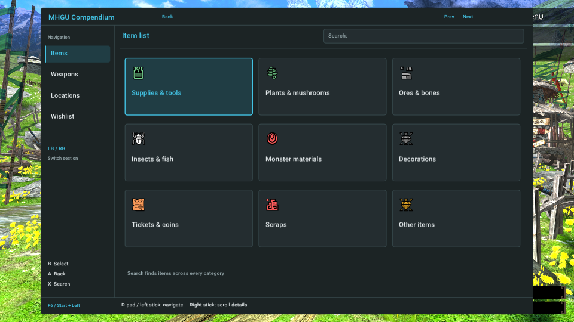
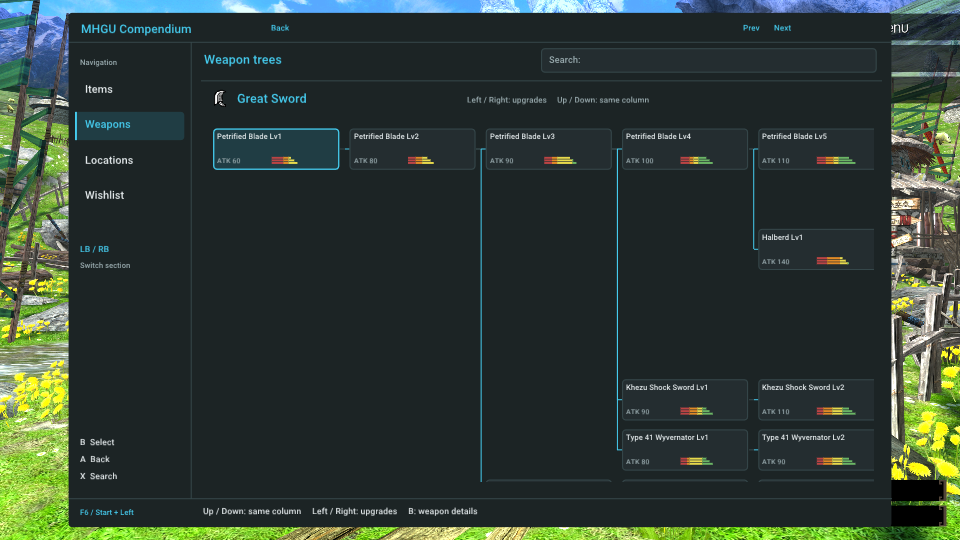
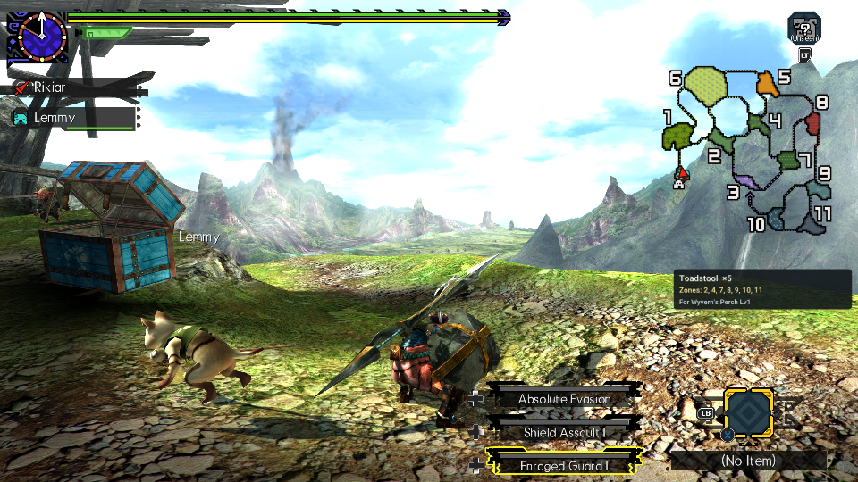

# Hunter's Compendium

A standalone Forge plugin for MHGURecomp and MHGU 1.4.0. Browse items, weapon
upgrade trees, crafting materials, gathering sources and a persistent wishlist.
The game continues while the browser is open.

[Download the release](https://github.com/Rikiar73574/mhgu-compendium/releases/latest)

[Build from source](docs/BUILD.md)

[Screenshots](docs/SCREENSHOTS.md)

- Start + D-pad Left opens or closes the Compendium; F6 is the keyboard shortcut.
- Xbox B selects; Xbox A goes back. LB/RB changes section.
- X opens controller search. Desktop typing also searches.
- R3 adds or removes a weapon recipe from the wishlist, including supported
  native smithy upgrade screens.
- In Wishlist, R3 removes the selected recipe; its Remove action also works with
  the mouse. Up/Down still selects materials, and removal is always manual.
- Material rows open their acquisition sources. The wishlist reads box and
  physical pouch inventory and stores its own `compendium_wishlist.txt` file.

Install one `hunters_compendium.nro` at
`romfs/nativeNX/plugins/hunters_compendium.nro` inside its mod folder, enable the
folder in Recomp, and restart. Keep the original game saves backed up.

This source includes the smithy hook compatibility change used with the
standalone Armor Fusion plugin. The earlier patched build passed both
load orders. This standalone build passed the complete installed mod stack on
Linux with stock MHGURecomp commit `a272b61`, using copied saves. See the
[validation record](docs/validation.md) for the exact artifact and coverage. All plugins share
Recomp's 12 MiB plugin memory region, including their BSS and loader alignment.

See [build instructions](docs/BUILD.md), [source provenance](THIRD_PARTY_NOTICES.md),
and the research notes under `docs/`.

Game-derived metadata, minimaps, cached illustrations and weapon renders are
local build inputs. They are not included in this source repository. The
renderer and generation paths are retained; supplying the same local generated
modules preserves the existing full UI. No HuntLog plugin or backend is needed
at runtime or to compile this standalone tree.

| Items | Weapon tree | Passive quest tracker |
| --- | --- | --- |
|  |  |  |
