# Actual game screenshots

Captured on Linux with stock MHGURecomp and the complete installed mod stack,
using the standalone Compendium build identified in [validation](validation.md).
These are actual game captures, not the emulated preview renderer.

| Items | Weapon types | Weapon tree |
| --- | --- | --- |
| 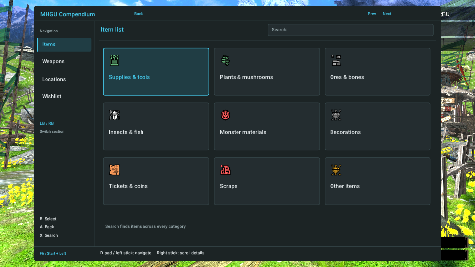 | 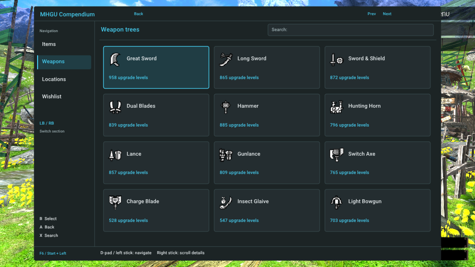 | 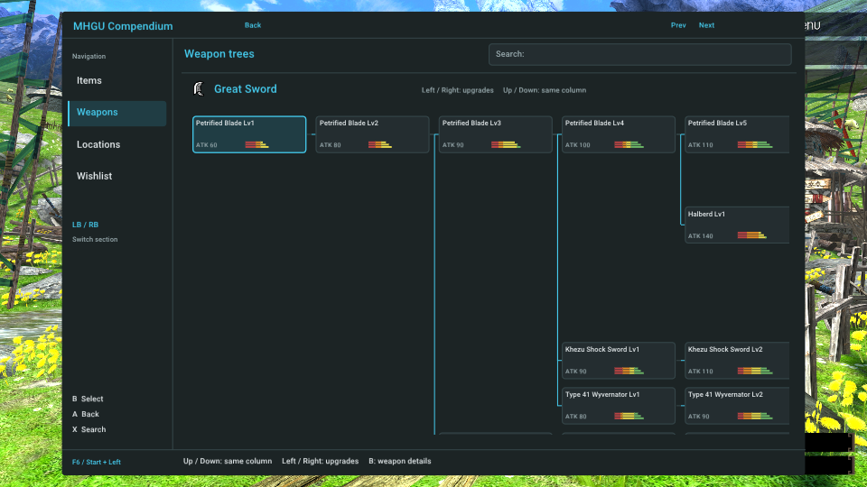 |

| Weapon details | Material sources | Wishlist |
| --- | --- | --- |
| 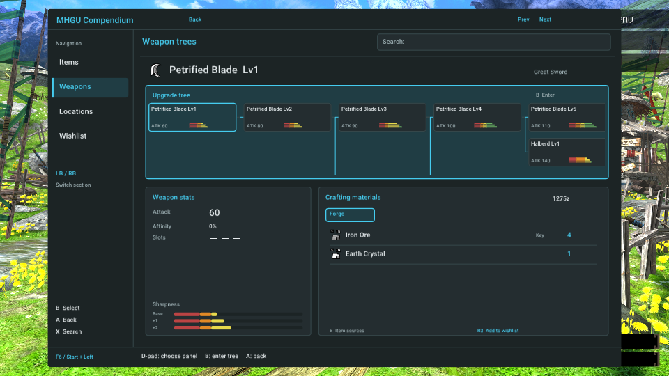 | 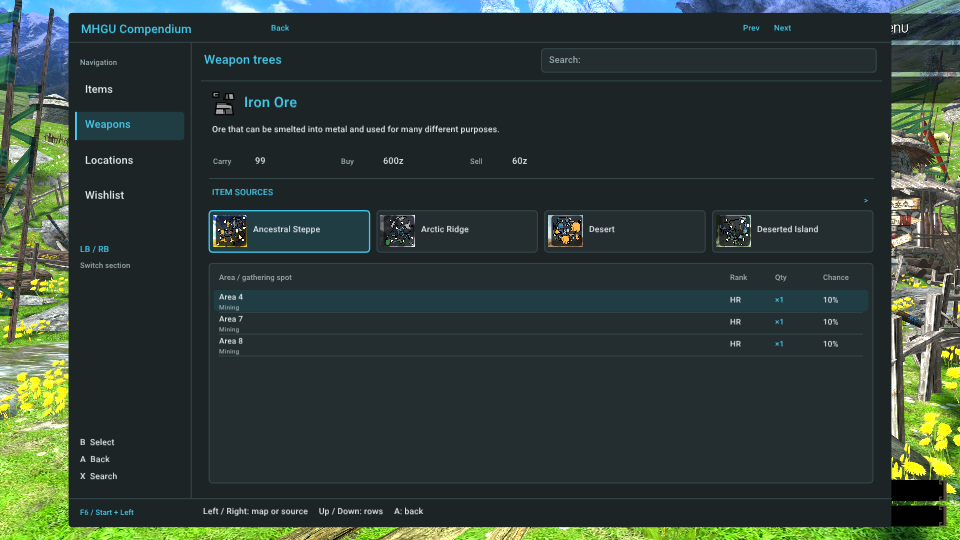 | 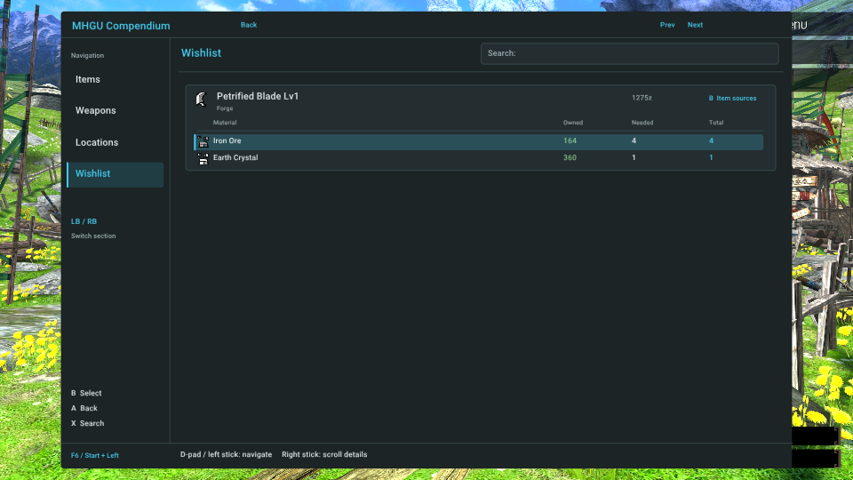 |

| Controller search | Locations | Passive quest tracker |
| --- | --- | --- |
| 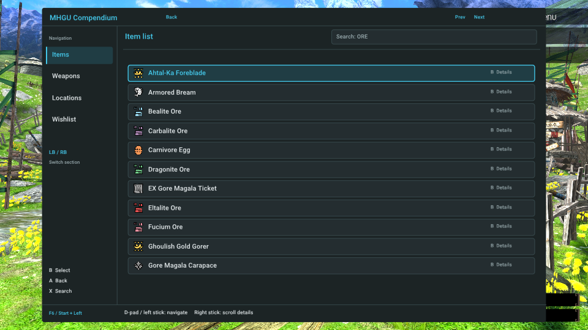 | 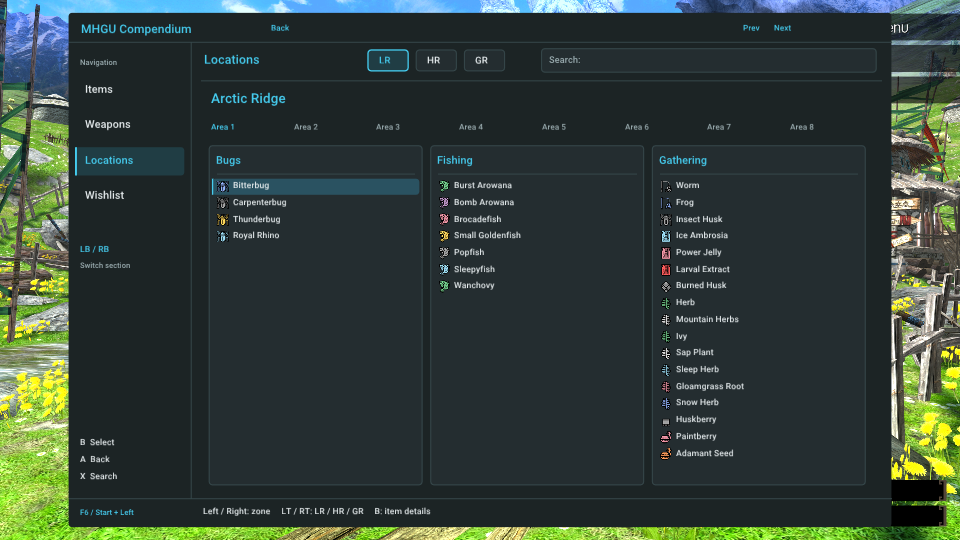 | 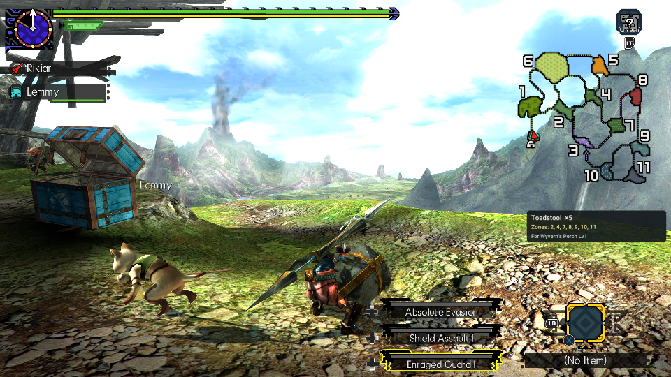 |

## Version 0.3.0

Captured in the separate hidden test game with copied save and HD textures/font.
See [UX validation](ux-validation.md) for artifact hashes and platform coverage.

| Item list | Controller search | Armor preview |
| --- | --- | --- |
| 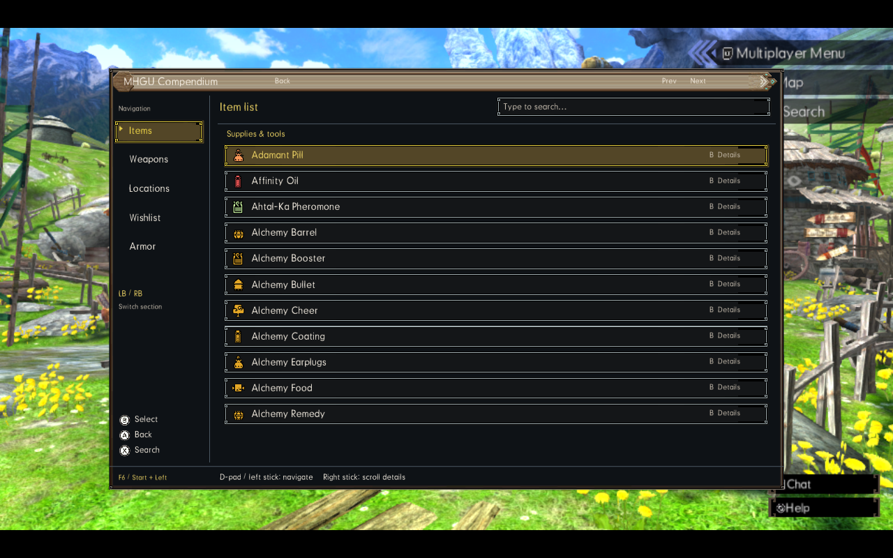 | 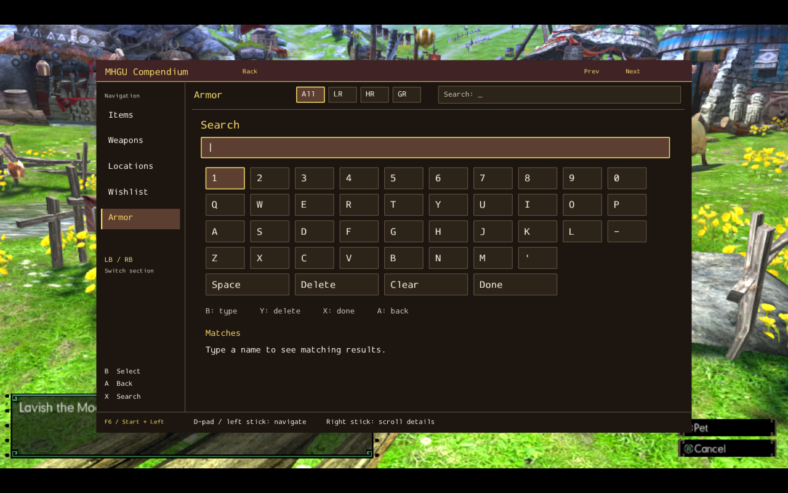 | 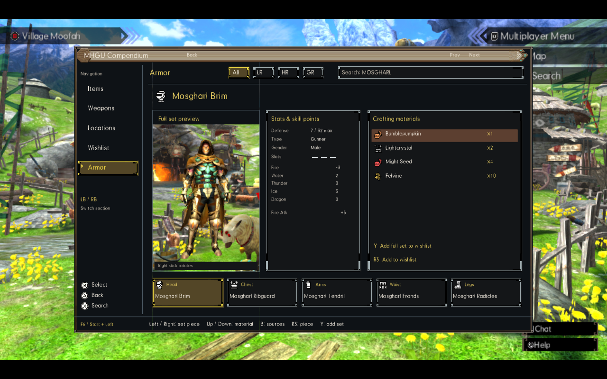 |

| Keyboard editing (Windows executable under Wine) | Exact byproduct level | Point requirements without an eligible route |
| --- | --- | --- |
| 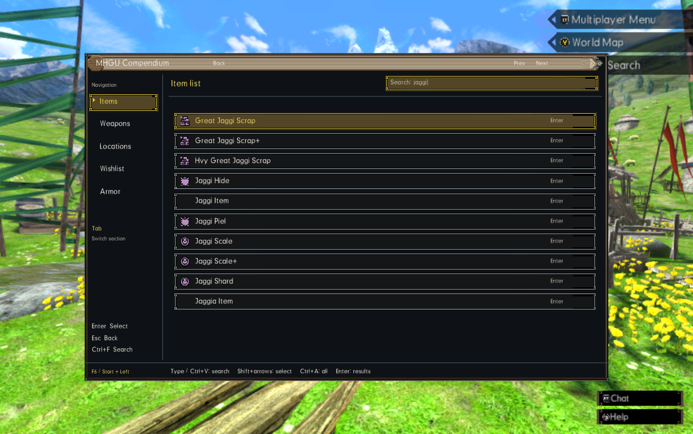 | 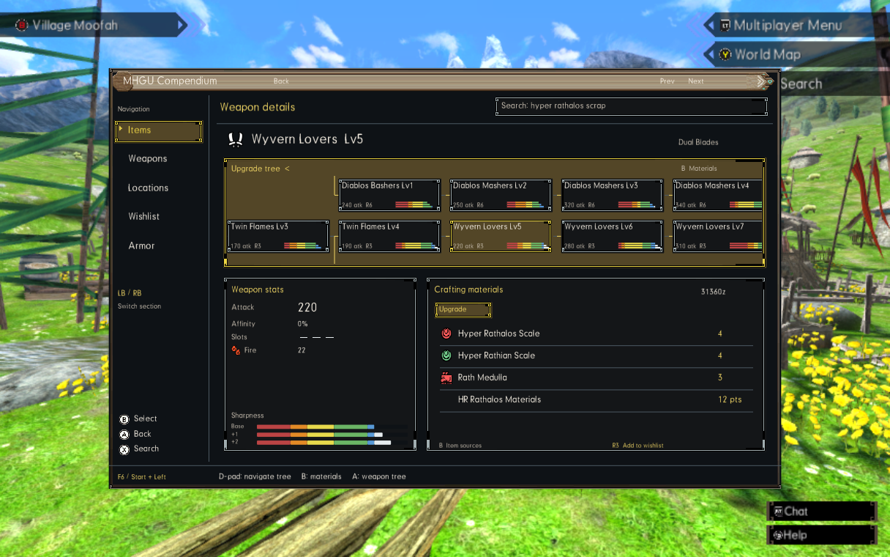 | 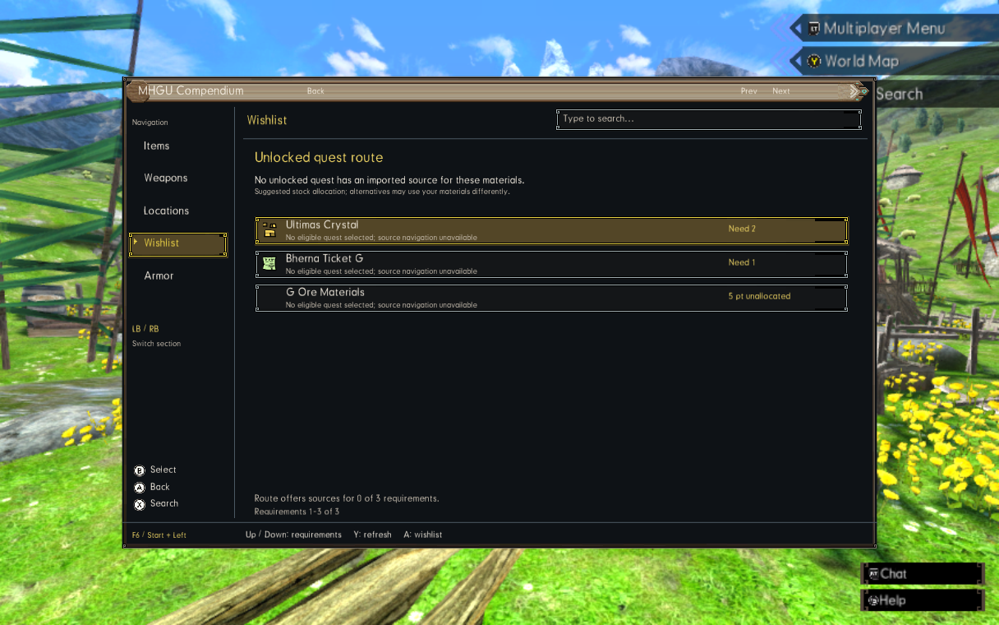 |
